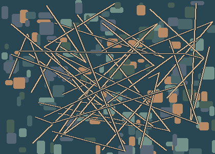

# Leonida Atlas

**Plan the stops before the run.** Pick a destination, check its nearest neighbour and build a multi-stop itinerary on a map you control.

## Try a three-stop route

[Download the atlas](https://github.com/Berserk-hub150/gta6-leonida-atlas/archive/refs/heads/main.zip), extract it and open `index.html`. Pick **Vice City**, add a stop, then add **Grassrivers** and **Port Gellhorn**. The line and total update with each stop. **Undo stop** removes the last leg.

## Bring your own map

Open **Use a gameplay map** and select an image plus a pin file following [pins.json](pins.json). Each pin has a name and normalized `x` and `y` coordinates. A point halfway across and a quarter down is `{"name":"Meeting point","x":0.5,"y":0.25}`.

The six region names come from Rockstar. Their positions on the bundled practice map are illustrative. Distances measure straight lines in atlas pixels. [Official GTA VI site](https://www.rockstargames.com/VI)

Want to turn that same map into a guessing game? Load it in [Leonida Guesser](https://github.com/Berserk-hub150/gta6-leonida-guesser).

---

[Explore the GTA VI project collection](https://github.com/Berserk-hub150/gta6-resource-index) · Independent fan project. Grand Theft Auto is a trademark of its respective owners.
